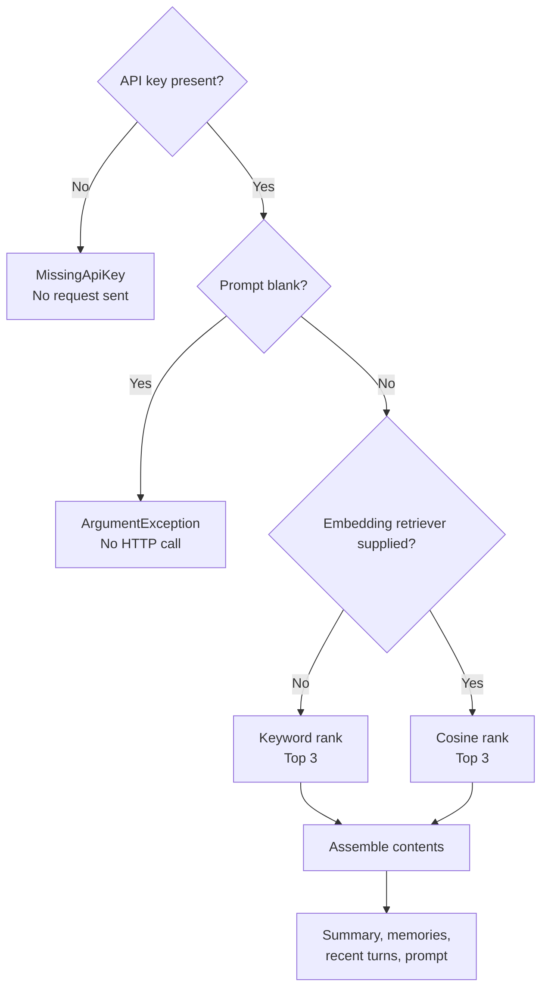
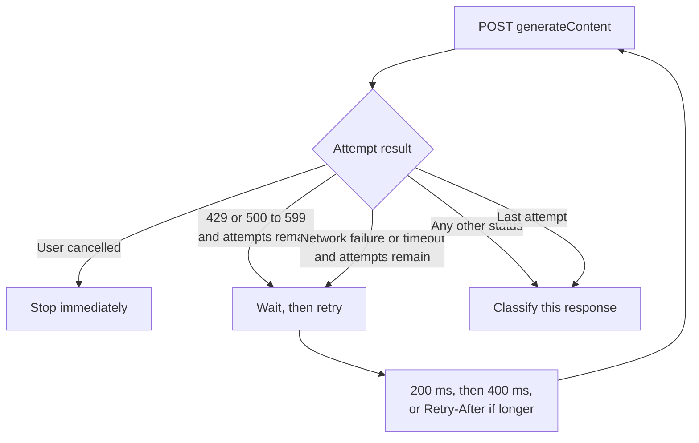
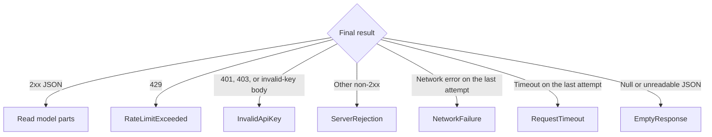
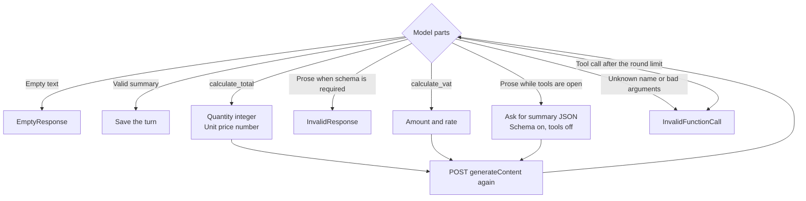
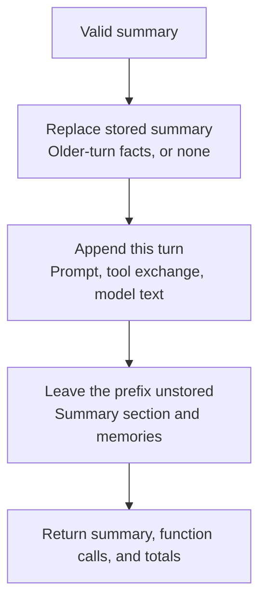

# Gemini generateContent flow

A real prompt calls `v1beta/models/{model}:generateContent`. The default model is `gemini-3.8-flash`, and the default timeout is 5 minutes. The API key is sent in the `x-goog-api-key` header.

History and the stored summary change only after the model returns a valid learning summary. Every stop before that leaves them as they were.

Green means the turn is saved. Blue means another attempt or another `generateContent` call. Red means the call stops and the stored history stays unchanged.

## Before the request

Keyword ranking is the default. Cosine ranking runs only when an `EmbeddingMemoryRetriever` is supplied. Memories that were never indexed are skipped. A blank query returns no memories.

The assembled request can contain:

1. A compact summary of older turns, within the summary token budget.
2. Up to three retrieved memories, within the memory token budget.
3. Recent complete turns, within the turn and history token limits.
4. The current prompt.

The summary and the memory section are a prefix. They are sent to the model and are not written into the transcript.

## HTTP attempt

Each call sends either the `calculate_total` and `calculate_vat` tool declarations, or the learning-summary JSON schema. It does not send both.

There are at most three attempts: the first call plus two retries.

Cancellation during the wait also stops immediately. It is not turned into `RequestTimeout`.

## Status and body

This classification uses the response from the last attempt.

`RESOURCE_EXHAUSTED` in the body is also `RateLimitExceeded`. `API_KEY_INVALID` or `API key not valid` in the body is `InvalidApiKey`.

## Model response

The client allows at most four tool rounds. While a tool round remains, and the model has not yet been asked to format a summary, tools are enabled. Otherwise the next call uses the summary schema.

A valid learning summary has a title, a summary, exactly three key points, and a difficulty of beginner, intermediate, or advanced.

Several tool calls in one response are executed before the follow-up request. The API key is removed from model text before it is stored or sent again.

## Saved turn

A failed call does not call `Replace` or `ReplaceSummary`.

The worker prints a `GeminiClientException` and waits for the next prompt. Typing `reset` as the role clears the session locally and does not call the API.
